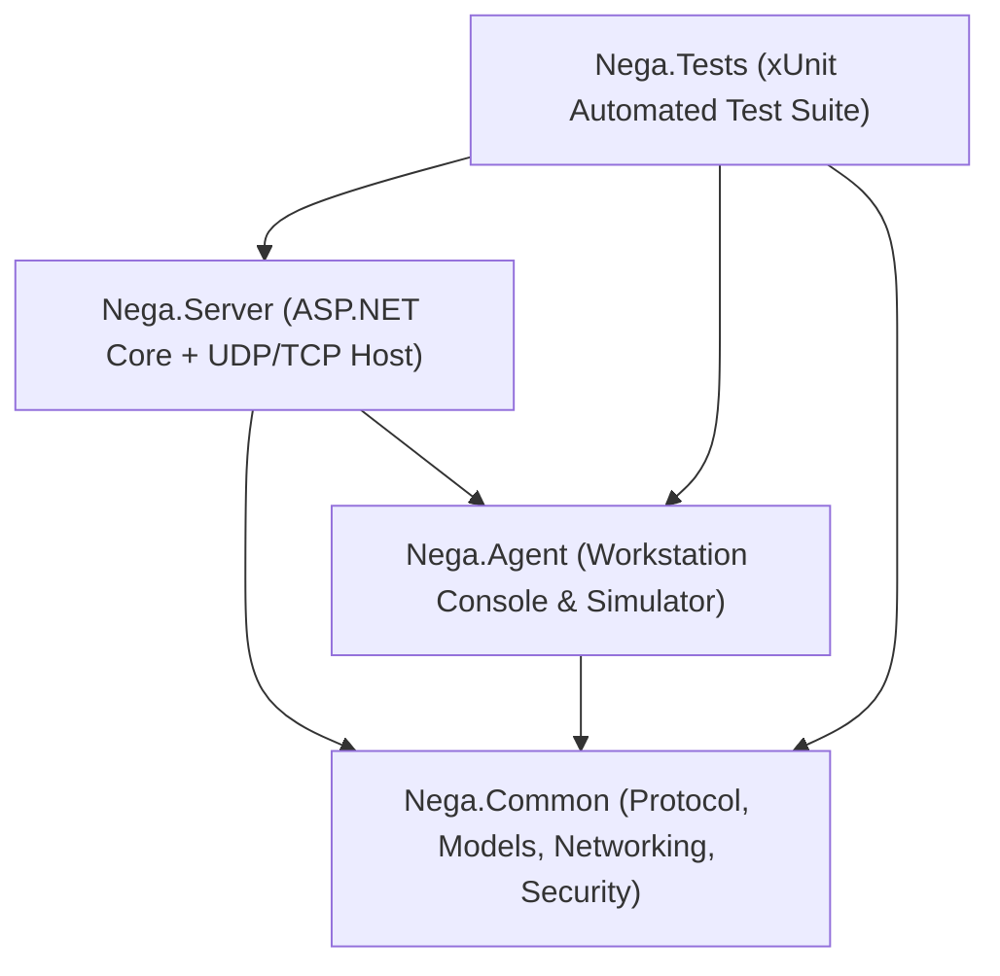
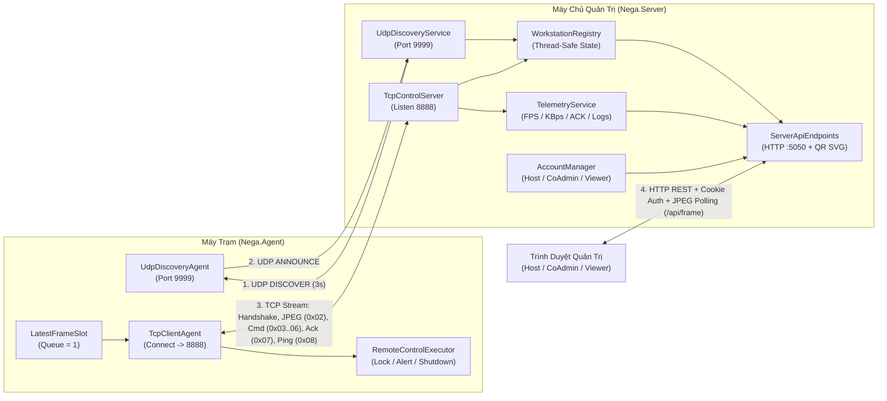

# Kiến Trúc Hệ Thống & Topology Mạng

## 1. Cấu Trúc Solution 3 Phân Hệ (`Nega.slnx`)

Mã nguồn hệ thống **Nega** được tổ chức tại thư mục gốc dưới dạng Solution .NET 8 (`Nega.slnx`), phân tách rạch ròi thành **3 dự án (Projects) thuộc tầng `src/`** và **1 dự án kiểm thử thuộc `tests/`**:

:::info[Vai trò từng phân hệ trong Solution]
* **`Nega.Common`:** Thư viện dùng chung không phụ thuộc hạ tầng web hay UI. Chứa hằng số giao thức (`ProtocolConstants`), bộ mã lệnh `PacketType`, khung nhị phân `PacketFramer`, DTO `DiscoveryModels`/`ControlModels`, tính toán Broadcast đa card mạng (`SubnetBroadcastHelper`), cấu hình `.env` (`NegaRuntimeConfig`) và xác thực `HMAC-SHA256` (`PacketAuthHelper`).
* **`Nega.Server`:** Đóng vai trò Máy chủ Trung tâm (`BackgroundService` + Minimal API + Web UI). Vận hành đồng thời dịch vụ UDP Discovery (`:9999`), máy chủ TCP Control (`:8888`), kho trạng thái `WorkstationRegistry`, trình quản lý phiên `AccountManager`, dịch vụ đo đạc `TelemetryService`, bộ sinh QR SVG offline `QrSvgGenerator`, cụm giả lập `LabSimulatorService` và máy chủ HTTP phục vụ giao diện Dashboard tại cổng `:5050`.
* **`Nega.Agent`:** Tác nhân chạy độc lập trên mỗi máy trạm (hoặc chạy hàng loạt ở chế độ `--simulate N`). Gồm bộ khám phá `UdpDiscoveryAgent`, tác nhân `TcpClientAgent` với hàng đợi `LatestFrameSlot`, bộ chụp & nén ảnh `ScreenCaptureService`/`SimpleJpegEncoder` và bộ thực thi lệnh `RemoteControlExecutor`.
* **`Nega.Tests`:** Bộ kiểm thử đơn vị xUnit xác minh tính đúng đắn của giao thức nhị phân, bảo mật HMAC, nén JPEG, hàng đợi conflation, quản lý trạng thái phòng máy, phân quyền tài khoản và bộ thực thi lệnh điều khiển.
:::

---

## 2. Kiến Trúc Đa Kênh Mạng (Multi-Plane Network Topology)

Thay vì dồn toàn bộ lưu lượng qua một giao thức duy nhất, Nega tách truyền thông mạng thành **3 mặt phẳng (Planes)** chuyên biệt theo đúng bản chất dữ liệu:

### Vì sao TCP luôn khởi tạo theo chiều `Agent -> Server`?
Trong thực tế phòng máy, nhiều máy trạm nằm sau tường lửa cục bộ (Windows Defender Firewall chặn kết nối đi vào - Inbound) hoặc thay đổi IP liên tục theo DHCP. Nếu Server chủ động mở kết nối tới IP của Client sẽ rất dễ bị chặn. Bằng cách để Server phát **UDP Broadcast `DISCOVER`** công bố cổng TCP `:8888`, mỗi `Nega.Agent` sẽ chủ động mở kết nối TCP đi ra (**Outbound** tới IP của Server). Ngay khi kết nối thiết lập xong, hai chiều truyền lệnh (Server gửi xuống Agent) và truyền luồng ảnh/ACK (Agent gửi lên Server) đều dùng chung kênh song công (**Full-Duplex**) này.

---

## 3. Phân Tầng Logic Phía `Nega.Server` (5 Tầng)

| Tầng | Namespace & Thành phần | Trách nhiệm chính |
|---|---|---|
| **Tầng 1 - Khám phá LAN** | `Nega.Server.Discovery` (`UdpDiscoveryService`) | Phát gói `DISCOVER` định kỳ 3s trên mọi subnet vật lý; thu nhận `ANNOUNCE`, kiểm tra chữ ký HMAC-SHA256 và cập nhật vào Registry. |
| **Tầng 2 - Điều phối TCP** | `Nega.Server.TcpServer` (`TcpControlServer`, `ClientSession`) | Lắng nghe cổng `:8888`; giữ `ConcurrentDictionary<string, ClientSession>`; đồng bộ ghi bằng `SemaphoreSlim(1, 1)` tránh trộn byte; gửi Ping giữ kết nối mỗi 5s. |
| **Tầng 3 - Trạng thái & Đo đạc** | `Nega.Server.State` (`WorkstationRegistry`, `TelemetryService`, `AccountManager`) | Hợp nhất trạng thái từ UDP & TCP; tính FPS/KBps trung bình trượt; theo dõi TTL Offline (10s); quản lý tài khoản & phiên Cookie (`HttpOnly`, hết hạn 8 giờ). |
| **Tầng 4 - Cầu nối API & Giả lập** | `Nega.Server.Bridge` (`ServerApiEndpoints`, `LabSimulatorService`, `QrSvgGenerator`) | Cung cấp Endpoint REST `/api/*`, lọc quyền `Host`/`CoAdmin`/`Viewer`, sinh mã QR SVG offline, quản lý vòng đời Agent cục bộ + `0..16` máy ảo. |
| **Tầng 5 - Trình diễn Web UI** | `wwwroot/` (`index.html`, `nega.css`, `nega-app.js`) | Giao diện 3 cột thích ứng Light/Dark Mode, cập nhật trạng thái bằng chu kỳ Polling (`450 ms`), phóng to luồng HD và điều phối Modal thao tác. |

---

## 4. Quản Lý Đa Luồng & Xử Lý Bất Đồng Bộ

Trong một phiên làm việc với `N` máy trạm đang trực tuyến:
* Mỗi `ClientSession` trên Server vận hành **2 tác vụ song song**: `ReceiveLoopAsync` đọc khung gói tin đến và `PingLoopAsync` gửi gói kiểm tra sống `0x08` mỗi 5 giây. Mọi lệnh ghi từ cả `PingLoopAsync` lẫn API điều khiển (`SendPacketAsync`) đi qua chung `SemaphoreSlim _writeLock = new(1, 1)` bên trong `PacketFramer.WritePacketAsync`, loại bỏ hoàn toàn lỗi đan xen dữ liệu (`Packet Interleaving`).
* Phía máy trạm (`TcpClientAgent`) cũng tách làm **3 vòng lặp bất đồng bộ độc lập**: `CaptureProducerLoopAsync` (chụp và nén JPEG rồi ghi đè vào `LatestFrameSlot`), `FrameSenderLoopAsync` (rút khung mới nhất từ slot gửi qua TCP) và `CommandReceiverLoopAsync` (đọc lệnh điều khiển & trả `PingPong`).
