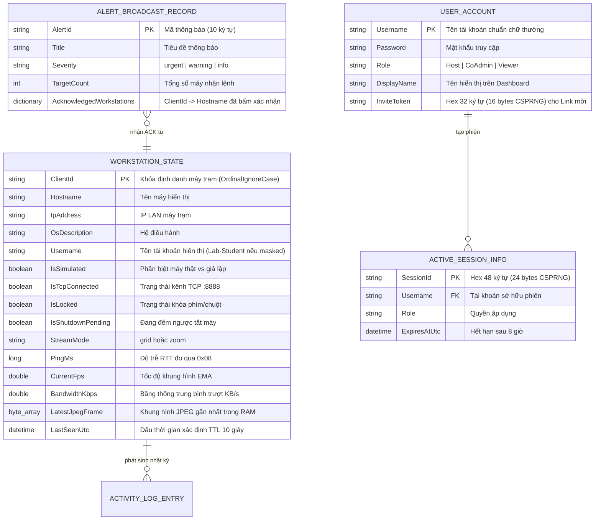

# Đặc Tả Giao Thức Mạng & Mô Hình Dữ Liệu

Do hệ thống **Nega** truyền tải dữ liệu thời gian thực ở tầng Transport và lưu trạng thái trực tiếp trong bộ nhớ tốc độ cao (In-Memory State Registry), thiết kế dữ liệu trung tâm của hệ thống tập trung vào **Định dạng khung gói tin nhị phân TCP**, **Lược đồ gói UDP Broadcast** và **Mô hình trạng thái bộ nhớ**.

---

## 1. Cấu Trúc Khung Nhị Phân TCP (`PacketFramer`)

Giao thức TCP bản chất là dòng byte liên tục (**Byte Stream**), không tự bảo toàn ranh giới từng thông điệp như UDP Datagram. Khi mạng bận, hai gói tin nhỏ có thể dính vào nhau (**Coalescing**) hoặc một ảnh JPEG 40 KB có thể bị tách làm nhiều đoạn (`ReadAsync` trả về từng phần - **Fragmentation**).

`Nega.Common.Protocol.PacketFramer` khắc phục hoàn toàn hai hiện tượng này bằng cấu trúc khung cố định phần đầu dài **7 byte** (`ProtocolConstants.HeaderSize = 7`):

```text
+------------+------------+--------------+-------------------------+--------------------------------+
|  Byte 0    |  Byte 1    |   Byte 2     |       Byte 3 .. 6       |       Byte 7 .. (7 + N - 1)    |
+------------+------------+--------------+-------------------------+--------------------------------+
| MagicHigh  | MagicLow   | PacketType   | PayloadLength           | Payload Data                   |
| (0xAA)     | (0x55)     | (1 byte)     | (4 bytes Int32 BigEnd)  | (N bytes: JSON UTF-8 / JPEG)   |
+------------+------------+--------------+-------------------------+--------------------------------+
```

### Quy tắc kiểm tra an toàn khi tách khung (`ReadPacketAsync`)
1. Vòng lặp `ReadExactAsync` chỉ kết thúc khi đọc đủ chính xác `7 bytes` Header; trả về `null` nếu socket đóng gọn (`bytesRead == 0`).
2. Kiểm tra 2 byte đầu phải khớp `0xAA 0x55`. Nếu sai lệch (do client lạ hoặc mất đồng bộ luồng), ném `InvalidDataException` và đóng phiên kết nối ngay lập tức.
3. Đọc độ dài bằng `BinaryPrimitives.ReadInt32BigEndian`. Giới hạn an toàn tối đa: `0 <= length <= ProtocolConstants.MaxPayloadSizeBytes` (`10 MB` = `10,485,760 bytes`) nhằm ngăn chặn tấn công tràn bộ nhớ (`OutOfMemoryException`) từ header giả mạo.
4. Tiếp tục `ReadExactAsync` đọc trọn vẹn `length` byte Payload trước khi tạo đối tượng `PacketEnvelope`.

---

## 2. Bảng Mã Lệnh Giao Thức TCP (`PacketType.cs`)

| Mã Hex | Enum `PacketType` | Chiều Truyền | Định Dạng Payload | Mô Tả Nghiệp Vụ |
|:---:|---|---|---|---|
| `0x01` | `Handshake` | Client -> Server | JSON (`HandshakePayload`) | Định danh `ClientId`, `Hostname`, `IpAddress`, `OsDescription`, `Username`, `ScreenWidth/Height`, `IsSimulated`, `TimestampUnixMs`, `AuthTag`. |
| `0x02` | `ScreenFrame` | Client -> Server | Raw Binary (`byte[]` JPEG) | Mảng byte nhị phân ảnh chụp màn hình chuẩn JPEG (`0xFF 0xD8 ... 0xFF 0xD9`). Không bọc JSON để tránh phình 33% dung lượng như Base64. |
| `0x03` | `CmdLockInput` | Server -> Client | JSON (`LockInputPayload`) | Yêu cầu khóa (`Locked = true`) hoặc mở khóa (`false`) kèm `CommandId`, `Message` và `FailSafeUnlockSeconds` (`30`). |
| `0x04` | `CmdShutdown` | Server -> Client | JSON (`ShutdownCommandPayload`) | Lệnh `shutdown` hoặc `cancel`, trễ `DelaySeconds` (`5..300`), cờ `DryRun` (Safe Mode) và `Reason`. |
| `0x05` | `CmdAlert` | Server -> Client | JSON (`EmergencyAlertPayload`) | Gửi cảnh báo (`AlertId`, `Title`, `Message`, `Severity`: `urgent`/`warning`/`info`, `RequireAck`). |
| `0x06` | `CmdStreamConfig` | Server -> Client | JSON (`StreamConfigPayload`) | Điều chỉnh chất lượng luồng JPEG động: `Width`, `Height`, `Quality`, `Fps`, `Mode` (`"grid"` hoặc `"zoom"`). |
| `0x07` | `Ack` | Client -> Server | JSON (`AckResponsePayload`) | Phản hồi trạng thái thực thi (`LOCK`, `UNLOCK`, `ALERT_READ`, `SHUTDOWN`, `CANCEL_SHUTDOWN`, `SHUTDOWN_COMPLETED`), `Success`, `Detail`. |
| `0x08` | `PingPong` | Hai chiều | JSON (`PingPongPayload`) | Server gửi `IsPong = false` định kỳ `5,000 ms`; Client trả lời `IsPong = true` giữ nguyên `SentAtUnixMs` để đo độ trễ `PingMs`. |

---

## 3. Lược Đồ Gói Tin UDP Broadcast (`:9999`)

```json
// Server phát Broadcast mỗi 3,000 ms (UdpDiscoverMessage)
{
  "type": "DISCOVER",
  "serverName": "NEGA-LAB-SERVER",
  "tcpPort": 8888,
  "timestampUnixMs": 1795110000000,
  "authTag": "<HMAC-SHA256-HEX hoặc rỗng nếu Dev mở>"
}

// Client Agent phản hồi tức thì & heartbeat mỗi 3,000 ms (UdpAnnounceMessage)
{
  "type": "ANNOUNCE",
  "clientId": "sim-may-01",
  "hostname": "MAY-01",
  "osDescription": "macOS Sequoia 15",
  "ipAddress": "10.10.0.101",
  "screenWidth": 1920,
  "screenHeight": 1080,
  "isLocked": false,
  "isSimulated": true,
  "timestampUnixMs": 1795110000120,
  "authTag": "<HMAC-SHA256-HEX hoặc rỗng>"
}
```

---

## 4. Mô Hình Dữ Liệu Trạng Thái Trong Bộ Nhớ (`Nega.Server.State`)



### Quy tắc tự động đánh dấu trạng thái (`WorkstationState.StatusBadge`)
* **`"Offline"`:** Khi `!IsTcpConnected` **và** khoảng thời gian `(DateTimeOffset.UtcNow - LastSeenUtc).TotalMilliseconds > 10000` (`ProtocolConstants.ClientOfflineTtlMs = 10s`). Cơ chế này giúp xử lý triệt để trạng thái kết nối đứt ngầm (**TCP Half-Open**) khi máy trạm bị rút cáp mạng hoặc tắt nguồn đột ngột.
* **`"Locked"`:** Khi máy vẫn còn hoạt động (hoặc chưa quá TTL) và `IsLocked == true`.
* **`"Online"`:** Trạng thái hoạt động bình thường.
