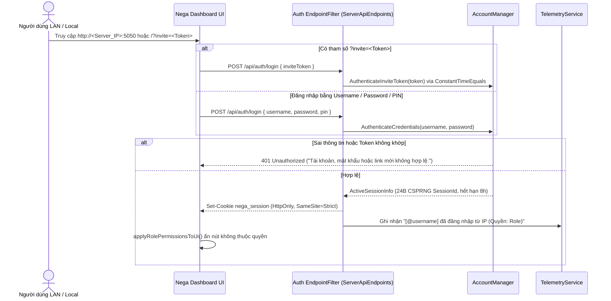

# Ma Trận Phân Quyền & Bảo Mật Hệ Thống

## 1. Phân Quyền 3 Vai Trò Trên Web Dashboard (`AccountManager`)

Để nhiều giảng viên, trợ giảng hoặc giám khảo cùng quan sát phòng máy từ xa qua LAN mà vẫn bảo đảm nguyên tắc đặc quyền tối thiểu (**Principle of Least Privilege**), `Nega.Server` triển khai **3 vai trò (Roles)** quản lý bởi `AccountManager`:

| Vai Trò (`Role`) | Tài Khoản Khởi Tạo Mặc Định | Mức Quyền Hạn Tổng Quát |
|---|---|---|
| **`Host`** | `admin` (mật khẩu lấy từ `NEGA_ADMIN_PIN` trong `.env` hoặc tự sinh 6 số bằng CSPRNG) | Máy chủ Chính: Toàn quyền giám sát, điều khiển phòng máy và **độc quyền** quản trị danh sách tài khoản, tạo Link mời 1 chạm và sinh mã QR. |
| **`CoAdmin`** | `coadmin` (mật khẩu 6 số ngẫu nhiên theo phiên) | Đồng Quản trị (Giảng viên phụ / Thành viên nhóm): Được xem toàn bộ màn hình và thực hiện mọi lệnh điều khiển (`Quét LAN`, `Khóa/Mở`, `Thông báo`, `Tắt máy`, chỉnh `Simulator`). |
| **`Viewer`** | `viewer` (mật khẩu 6 số ngẫu nhiên theo phiên) | Chỉ Theo dõi (Khách / Giảng viên dự giờ): Được xem lưới màn hình, chuyển phóng to `Zoom HD` cá nhân trên trình duyệt và xem nhật ký, nhưng **bị chặn toàn bộ thao tác tác động phòng máy**. |

---

## 2. Bảng Ma Trận Phân Quyền Chi Tiết Theo API

Kiểm tra thẩm quyền thực thi tại [`ServerApiEndpoints.cs`](../../src/Nega.Server/Bridge/ServerApiEndpoints.cs) qua hai hàm gác cổng `CanControl(session)` và `IsHost(session)`:

| Nhóm Chức Năng / Endpoint | `Host` | `CoAdmin` | `Viewer` | Mã HTTP Khi Bị Từ Chối |
|---|:---:|:---:|:---:|:---:|
| Xem tổng quan, danh sách máy & nhật ký (`GET /api/overview`) | [Cho phép] | [Cho phép] | [Cho phép] | `401` (nếu chưa đăng nhập) |
| Tải khung hình JPEG (`GET /api/frame/{clientId}`) | [Cho phép] | [Cho phép] | [Cho phép] | `401` / `404` |
| Phóng to / thu gọn luồng xem (`POST /api/control/stream-mode`) | [Cho phép] | [Cho phép] | [Cho phép] | `401` |
| Quét mạng LAN tức thì (`POST /api/discover`) | [Cho phép] | [Cho phép] | [Không cho phép] | `403 Forbidden` |
| Khóa / Mở khóa chuột & phím (`POST /api/control/lock`) | [Cho phép] | [Cho phép] | [Không cho phép] | `403 Forbidden` |
| Phát thông báo khẩn cấp (`POST /api/control/alert`) | [Cho phép] | [Cho phép] | [Không cho phép] | `403 Forbidden` |
| Tắt máy / Hủy tắt máy (`POST /api/control/shutdown`) | [Cho phép] | [Cho phép] | [Không cho phép] | `403 Forbidden` |
| Điều chỉnh số máy Simulator (`POST /api/simulator`) | [Cho phép] | [Cho phép] | [Không cho phép] | `403 Forbidden` |
| Xem danh sách tài khoản, link mời (`GET /api/accounts`) | [Cho phép] | [Không cho phép] | [Không cho phép] | `403 Forbidden` |
| Tạo / thu hồi tài khoản phụ (`POST`, `DELETE /api/accounts`) | [Cho phép] | [Không cho phép] | [Không cho phép] | `403 Forbidden` |

---

## 3. Cơ Chế Xác Thực Kép & Bảo Mật Đa Lớp

### 4 Lớp Bảo Mật Cốt Lõi
1. **Bảo vệ Cookie & Localhost Guard:**
   * Phiên đăng nhập sử dụng Cookie `nega_session` gắn cờ **`HttpOnly`** và **`SameSite=Strict`** (chống đọc Cookie bằng JavaScript XSS và chống CSRF), thời hạn **8 giờ**.
   * Mặc định, trình duyệt mở trực tiếp tại máy chủ (`IPAddress.IsLoopback == true`) được nhận diện quyền `Host` tức thì để tiện thao tác; có thể bật xác thực bắt buộc cả trên localhost bằng biến `NEGA_REQUIRE_PIN_ON_LOCALHOST=true`.
   * Hỗ trợ Header `X-Nega-Admin-Pin` so khớp bằng `CryptographicOperations.FixedTimeEquals` phục vụ kiểm thử tự động hóa.
2. **Xác thực gói tin Cụm LAN (HMAC-SHA256 + Anti-Replay):**
   * Khi khai báo biến `NEGA_CLUSTER_KEY` giống nhau trong `.env` của Server và Agent, [`PacketAuthHelper`](../../src/Nega.Common/Security/PacketAuthHelper.cs) ký và kiểm tra toàn bộ gói `UDP DISCOVER`, `UDP ANNOUNCE` và `TCP Handshake` kèm cửa sổ thời gian **±120 giây (`MaxClockSkewMs = 120_000`)** nhằm ngăn chặn máy lạ trong cùng Wi-Fi nghe lén, phát lại gói cũ (**Replay Attack**) hoặc giả danh Server/Client.
3. **Ẩn danh thông tin nhạy cảm (`MaskHostIdentity = true`):**
   * Mặc định che giấu tên máy tính cá nhân và tên user hệ điều hành thật của người lập trình thành `"NEGA-LAB-SERVER"` / `"HOST-MASTER-PC"` / `"Lab-Student"`.
4. **An toàn Tắt nguồn & Chống chèn lệnh Shell (`Safe Mode`):**
   * Cờ `NEGA_ALLOW_REAL_SHUTDOWN=false` khóa cứng toàn bộ lệnh tắt máy ở chế độ mô phỏng đếm ngược (`DryRun = true`). Khi bật chạy thật trên Windows, [`RemoteControlExecutor.SanitizeShutdownComment`](../../src/Nega.Agent/Control/RemoteControlExecutor.cs#L219-L224) lọc bỏ ký tự điều khiển và ký tự vỏ (`"`, `&`, `|`, `;`), giới hạn tối đa 80 ký tự trước khi gọi `shutdown /s /t ...`.

---

## 4. Định Hướng Phân Quyền 2 Vai Trò Thi Cử `[Đề xuất Giai đoạn 2]`

Trong đề cương mở rộng cho bài toán tổ chức thi phòng máy, hệ thống bổ sung thêm tầng **Ủy quyền Thí sinh -> Giám thị (Permission Consent Handshake)**:
* **Role 1 (Người theo dõi / Giám thị):** Tạo Phòng thi với Mã phòng ngẫu nhiên, nhận luồng giám sát và phát lệnh khóa OS / thông báo / tắt máy lên các máy thí sinh đã xác nhận đồng thuận.
* **Role 2 (Máy bị theo dõi / Thí sinh):** Nhập Mã phòng hoặc mở đường dẫn `/join`, kiểm tra danh sách 4 nhóm quyền (Chia sẻ màn hình thật, Khóa phím chuột toàn cục, Thông báo nổi, Điều khiển từ xa) và **phải chủ động bấm "Đồng ý cấp quyền tham gia thi"** trước khi phiên giám sát có hiệu lực. Tự động thu hồi quyền (**Auto-Revoke**) ngay khi kết thúc ca thi.
