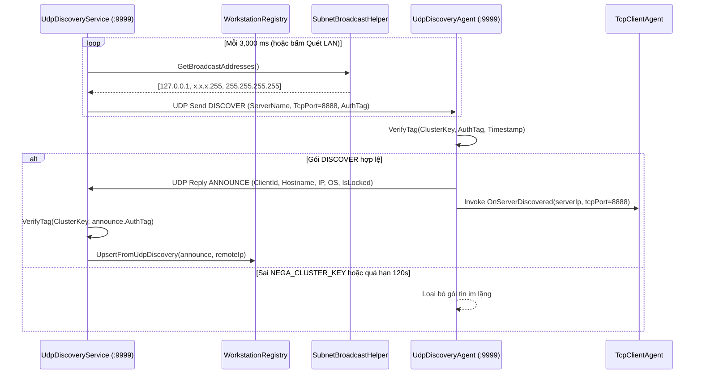

# F01 - Tự Động Nhận Diện Máy Trạm Qua UDP Broadcast LAN

## 1. Mục Tiêu & Yêu Cầu Kỹ Thuật

Chức năng `F01` giải quyết bài toán tự động ghép nối giữa Máy chủ Quản trị (`Nega.Server`) và hàng chục máy trạm (`Nega.Agent`) trong cùng mạng LAN/Wi-Fi sử dụng IP cấp động DHCP mà không cần khai báo thủ công địa chỉ IP từng máy.

### Các yêu cầu cốt lõi
* **Directed Subnet Broadcast đa card mạng:** Tính toán chính xác địa chỉ Broadcast của từng interface vật lý/Wi-Fi theo công thức `IP | ~SubnetMask` thông qua [`SubnetBroadcastHelper`](../../../src/Nega.Common/Networking/SubnetBroadcastHelper.cs) kết hợp `127.0.0.1` và `255.255.255.255`, tránh hiện tượng `No route to host` hoặc gói tin bị đẩy nhầm vào card mạng ảo (VPN/Docker).
* **Tái sử dụng cổng Socket đa tiến trình (`SO_REUSEADDR` + `SO_REUSEPORT`):** Cấu hình cờ socket `ReuseAddress = true` và mã `0x0200` (`SO_REUSEPORT`) trên macOS để Server và nhiều Agent giả lập cùng chạy song song trên một máy vẫn nhận trọn vẹn gói UDP cổng `:9999`.
* **Chống giả mạo gói tin trong LAN mở:** Khi thiết lập `NEGA_CLUSTER_KEY`, mọi gói `DISCOVER` và `ANNOUNCE` đều kèm chữ ký `HMAC-SHA256` (`AuthTag`) cùng kiểm tra sai lệch thời gian tối đa `±120 giây`.
* **Fallback chỉ định IP thủ công:** Khi chạy ở các mạng Wi-Fi trường học có chính sách chặn gói Broadcast (`AP Isolation`), cho phép khởi chạy Agent với tham số `--server <IP_LAN_SERVER>` để kết nối trực tiếp TCP `:8888`.

---

## 2. Luồng Xử Lý Giao Thức (Sequence Diagram)

---

## 3. Các Tệp Mã Nguồn & Kiểm Thử Triển Khai

* **Dịch vụ UDP Server:** [`src/Nega.Server/Discovery/UdpDiscoveryService.cs`](../../../src/Nega.Server/Discovery/UdpDiscoveryService.cs)
* **Tác nhân UDP Client:** [`src/Nega.Agent/Discovery/UdpDiscoveryAgent.cs`](../../../src/Nega.Agent/Discovery/UdpDiscoveryAgent.cs)
* **Mô hình gói & Subnet Broadcast:** [`src/Nega.Common/Models/DiscoveryModels.cs`](../../../src/Nega.Common/Models/DiscoveryModels.cs), [`src/Nega.Common/Networking/SubnetBroadcastHelper.cs`](../../../src/Nega.Common/Networking/SubnetBroadcastHelper.cs)
* **Xác thực gói HMAC:** [`src/Nega.Common/Security/PacketAuthHelper.cs`](../../../src/Nega.Common/Security/PacketAuthHelper.cs)
* **Kiểm thử tự động:** [`tests/Nega.Tests/TelemetryAndNetworkTests.cs`](../../../tests/Nega.Tests/TelemetryAndNetworkTests.cs), [`tests/Nega.Tests/PacketAuthHelperTests.cs`](../../../tests/Nega.Tests/PacketAuthHelperTests.cs)
