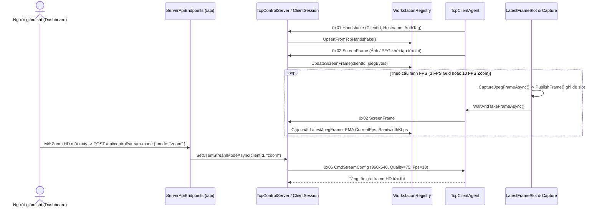

# F02 - Truyền Luồng Màn Hình JPEG Qua TCP & Zoom HD

## 1. Mục Tiêu & Yêu Cầu Kỹ Thuật

Chức năng `F02` đảm nhận truyền tải liên tục hình ảnh màn hình của tất cả máy trạm về Máy chủ Quản trị trên kênh TCP `:8888` với độ trễ thấp, hình ảnh sắc nét khi phóng to và tiêu tốn băng thông hợp lý khi giám sát cùng lúc nhiều máy.

### Các yêu cầu cốt lõi
* **Đóng khung nhị phân chống dính gói (`PacketFramer`):** Đóng gói mảng byte JPEG nguyên bản (không Base64) với phần đầu `7 bytes` `[0xAA][0x55][0x02][Length Big-Endian]`, tách khung bằng vòng lặp `ReadExactAsync`.
* **Hàng đợi 1 phần tử chống TCP Buffer Bloat (`LatestFrameSlot`):** Luồng chụp ảnh liên tục ghi đè khung hình mới nhất bằng `Interlocked.Exchange`; luồng gửi TCP chỉ rút khung mới nhất để đẩy lên mạng, triệt tiêu hiện tượng hình bị trễ hàng chục giây khi mạng chậm.
* **Bộ mã hóa JPEG Baseline thuần C# (`SimpleJpegEncoder`):** Cài đặt hoàn chỉnh chuyển đổi RGB -> YCbCr, biến đổi Cosine rời rạc 2D (`8×8 DCT`), lượng tử hóa theo Q-Table chất lượng `Quality`, chạy ZigZag và mã hóa Huffman (byte stuffing `0xFF -> 0xFF 0x00`), không phụ thuộc thư viện C/native. Hỗ trợ chụp màn hình macOS thật thông qua `/usr/sbin/screencapture` + `/usr/bin/sips` khi bật `NEGA_ALLOW_OS_CAPTURE=true`.
* **Tối ưu băng thông thích ứng (Grid vs Zoom HD):** Mặc định truyền độ phân giải nhỏ (`480×270`, chất lượng `45%`, `3 FPS`) khi xem lưới. Khi người giám sát bấm vào một máy để phóng to, Server gửi gói `0x06 CMD_STREAM_CONFIG` nâng lên chuẩn **Zoom HD** (`960×540`, chất lượng `75%`, `10 FPS`).

---

## 2. Luồng Xử Lý & Chuyển Đổi Chế Độ Luồng

---

## 3. Các Tệp Mã Nguồn & Kiểm Thử Triển Khai

* **Đóng khung & TCP Server:** [`src/Nega.Common/Protocol/PacketFramer.cs`](../../../src/Nega.Common/Protocol/PacketFramer.cs), [`src/Nega.Server/TcpServer/ClientSession.cs`](../../../src/Nega.Server/TcpServer/ClientSession.cs)
* **TCP Client & Single-Slot Queue:** [`src/Nega.Agent/TcpClient/TcpClientAgent.cs`](../../../src/Nega.Agent/TcpClient/TcpClientAgent.cs), [`src/Nega.Agent/TcpClient/LatestFrameSlot.cs`](../../../src/Nega.Agent/TcpClient/LatestFrameSlot.cs)
* **Chụp & Mã hóa JPEG Baseline:** [`src/Nega.Agent/Capture/ScreenCaptureService.cs`](../../../src/Nega.Agent/Capture/ScreenCaptureService.cs), [`src/Nega.Agent/Capture/SimpleJpegEncoder.cs`](../../../src/Nega.Agent/Capture/SimpleJpegEncoder.cs)
* **Kiểm thử tự động:** [`tests/Nega.Tests/PacketFramerTests.cs`](../../../tests/Nega.Tests/PacketFramerTests.cs), [`tests/Nega.Tests/SimpleJpegEncoderAndCaptureTests.cs`](../../../tests/Nega.Tests/SimpleJpegEncoderAndCaptureTests.cs), [`tests/Nega.Tests/LatestFrameSlotTests.cs`](../../../tests/Nega.Tests/LatestFrameSlotTests.cs)
