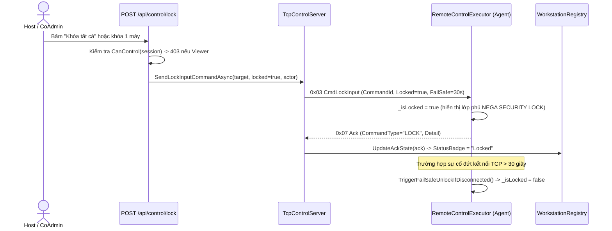

# F03 - Khóa Chuột / Bàn Phím & Cơ Chế Fail-Safe 30s

## 1. Mục Tiêu & Yêu Cầu Kỹ Thuật

Chức năng `F03` cho phép Giảng viên hoặc Đồng Quản trị (`Host` / `CoAdmin`) khóa nhanh chuột và bàn phím của một máy trạm cụ thể hoặc đồng loạt toàn phòng máy (`targetClientId = "ALL"`) để yêu cầu sinh viên tập trung lắng nghe hướng dẫn hoặc chốt giờ nộp bài.

### Các yêu cầu cốt lõi
* **Điều phối đơn lẻ hoặc hàng loạt qua TCP Control:** Server gửi gói `0x03 CMD_LOCK_INPUT` (`LockInputPayload`) qua `TcpControlServer.SendLockInputCommandAsync`.
* **Phản hồi trạng thái tức thì kèm lớp phủ trực quan:** `RemoteControlExecutor.ExecuteLockCommandAsync` cập nhật trạng thái `_isLocked` và gửi ngay gói `0x07 ACK` (`LOCK` hoặc `UNLOCK`) về Server; đồng thời `ScreenCaptureService` vẽ lớp phủ **NEGA SECURITY LOCK** màu đỏ cảnh báo trên luồng màn hình máy trạm để Dashboard nhận diện trực quan.
* **Cơ chế An toàn Tự mở khóa (Fail-safe Auto-Unlock 30s):** Nếu máy trạm bị mất kết nối mạng tới Server (rớt Wi-Fi, Server tắt đột ngột) liên tục từ `30 giây` trở lên (`ProtocolConstants.FailSafeAutoUnlockSeconds = 30`) trong khi đang ở trạng thái khóa, vòng đời kết nối ở `TcpClientAgent` tự động kích hoạt `TriggerFailSafeUnlockIfDisconnected()` để không bao giờ giam khóa máy trạm vĩnh viễn.
* **Ghi nhận dấu vết thao tác:** Nhật ký Server lưu đầy đủ định danh tài khoản đã phát lệnh (`[@username] Đã gửi lệnh Khóa chuột/bàn phím...`).

---

## 2. Luồng Xử Lý Khóa Máy & Fail-Safe (Sequence Diagram)

---

## 3. Các Tệp Mã Nguồn & Kiểm Thử Triển Khai

* **Endpoint khóa & kiểm tra quyền:** [`src/Nega.Server/Bridge/ServerApiEndpoints.cs`](../../../src/Nega.Server/Bridge/ServerApiEndpoints.cs)
* **Phát lệnh TCP đa máy:** [`src/Nega.Server/TcpServer/TcpControlServer.cs`](../../../src/Nega.Server/TcpServer/TcpControlServer.cs)
* **Thực thi khóa & Fail-safe Agent:** [`src/Nega.Agent/Control/RemoteControlExecutor.cs`](../../../src/Nega.Agent/Control/RemoteControlExecutor.cs), [`src/Nega.Agent/TcpClient/TcpClientAgent.cs`](../../../src/Nega.Agent/TcpClient/TcpClientAgent.cs)
* **Kiểm thử tự động:** [`tests/Nega.Tests/RemoteControlExecutorTests.cs`](../../../tests/Nega.Tests/RemoteControlExecutorTests.cs), [`tests/Nega.Tests/WorkstationRegistryTests.cs`](../../../tests/Nega.Tests/WorkstationRegistryTests.cs)
