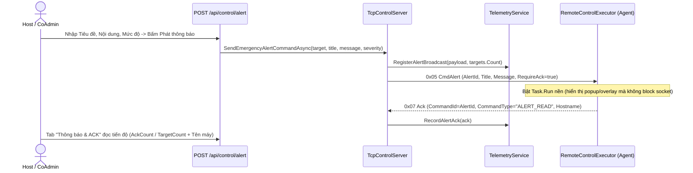

# F04 - Phát Thông Báo Khẩn Cấp & Theo Dõi Xác Nhận (ACK)

## 1. Mục Tiêu & Yêu Cầu Kỹ Thuật

Chức năng `F04` hỗ trợ Giảng viên / Quản trị viên phát thông báo khẩn cấp tới từng máy hoặc toàn bộ phòng máy (`0x05 CMD_ALERT`) và kiểm đếm theo thời gian thực xem bao nhiêu máy đã nhận và xác nhận đã đọc thông báo đó (`0x07 ACK` với `CommandType = "ALERT_READ"`).

### Các yêu cầu cốt lõi
* **Phân loại mức độ khẩn cấp:** Hỗ trợ 3 mức `Severity` (`"urgent"`, `"warning"`, `"info"`) kèm tiêu đề, nội dung tùy chỉnh và mã định danh thông báo `AlertId` dài 10 ký tự.
* **Xử lý bất đồng bộ chống chặn luồng TCP (Non-blocking Alert):** Khi nhận gói `CmdAlert`, [`RemoteControlExecutor.ExecuteEmergencyAlert`](../../../src/Nega.Agent/Control/RemoteControlExecutor.cs#L91-L138) khởi chạy tác vụ nền `Task.Run` thay vì chờ người dùng tắt hộp thoại trên luồng chính `CommandReceiverLoopAsync`. Nhờ vậy, kênh nhận gói `PingPong` và các lệnh khác trên máy trạm vẫn duy trì thông suốt tuyệt đối.
* **Thống kê tỷ lệ đọc tại TelemetryService:** Khi phát lệnh, Server gọi `RegisterAlertBroadcast(payload, targetCount)`. Mỗi khi nhận gói `ACK` khớp `AlertId`, `RecordAlertAck(ack)` bổ sung máy trạm vào `ConcurrentDictionary<string, string> AcknowledgedWorkstations`, hiển thị trực tiếp tỷ lệ `AckCount / TargetCount` và danh sách tên máy đã đọc trong tab **Thông báo & ACK**.

---

## 2. Luồng Xử Lý Thông Báo & Đếm ACK (Sequence Diagram)

---

## 3. Các Tệp Mã Nguồn & Kiểm Thử Triển Khai

* **Ghi nhận & tổng hợp ACK:** [`src/Nega.Server/State/TelemetryService.cs`](../../../src/Nega.Server/State/TelemetryService.cs)
* **Điều phối lệnh Alert:** [`src/Nega.Server/TcpServer/TcpControlServer.cs`](../../../src/Nega.Server/TcpServer/TcpControlServer.cs), [`src/Nega.Server/TcpServer/ClientSession.cs`](../../../src/Nega.Server/TcpServer/ClientSession.cs)
* **Thực thi thông báo bất đồng bộ:** [`src/Nega.Agent/Control/RemoteControlExecutor.cs`](../../../src/Nega.Agent/Control/RemoteControlExecutor.cs)
* **Kiểm thử tự động:** [`tests/Nega.Tests/TelemetryAndNetworkTests.cs`](../../../tests/Nega.Tests/TelemetryAndNetworkTests.cs), [`tests/Nega.Tests/RemoteControlExecutorTests.cs`](../../../tests/Nega.Tests/RemoteControlExecutorTests.cs)
