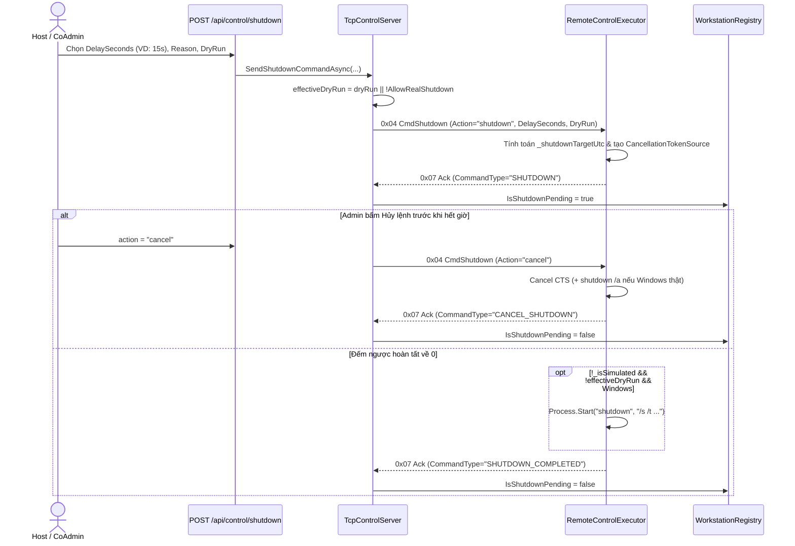

# F05 - Tắt Máy Từ Xa Có Đếm Ngược, Hủy Lệnh & Safe Mode

## 1. Mục Tiêu & Yêu Cầu Kỹ Thuật

Chức năng `F05` cho phép kết thúc ca thực hành bằng lệnh tắt nguồn hàng loạt hoặc đơn lẻ (`0x04 CMD_SHUTDOWN`), đồng thời thiết lập các hàng rào an toàn nghiêm ngặt để phòng tránh mất dữ liệu khi kiểm thử hoặc thao tác nhầm.

### Các yêu cầu cốt lõi
* **Đếm ngược có kiểm soát (`5..300 giây`) & Hủy lệnh khẩn cấp (`cancel`):** Khi phát lệnh tắt máy, máy trạm bắt đầu đếm ngược và gửi ngay `ACK (SHUTDOWN)`. Trong khoảng trễ trước khi hết giờ, người quản trị có thể bấm Hủy tắt máy (`action: "cancel"`) để hủy `CancellationTokenSource` đếm ngược (và chạy `shutdown /a` nếu là Windows thật).
* **Safe Mode / Dry-Run cưỡng chế mặc định:** Dù giao diện có tùy chọn gửi `DryRun`, máy chủ và máy trạm đều kiểm tra lại biến môi trường `NEGA_ALLOW_REAL_SHUTDOWN`. Khi biến này là `false` (mặc định trong `.env.example` và `NegaRuntimeConfig`), cờ `effectiveDryRun = cmd.DryRun || !NegaRuntimeConfig.Current.AllowRealShutdown` luôn ép chạy mô phỏng đếm ngược an toàn, tuyệt đối không tắt máy thật.
* **Kháng tấn công Shell Injection:** Chuỗi lý do tắt máy (`Reason`) được đưa qua hàm [`SanitizeShutdownComment`](../../../src/Nega.Agent/Control/RemoteControlExecutor.cs#L219-L224) loại bỏ ký tự điều khiển và `"`, `&`, `|`, `;`, cắt tối đa 80 ký tự trước khi gọi tiến trình hệ điều hành với `UseShellExecute = false`.

---

## 2. Luồng Thực Thi & Hủy Tắt Máy (Sequence Diagram)

---

## 3. Các Tệp Mã Nguồn & Kiểm Thử Triển Khai

* **Kiểm soát cờ Safe Mode & điều phối:** [`src/Nega.Server/TcpServer/TcpControlServer.cs`](../../../src/Nega.Server/TcpServer/TcpControlServer.cs), [`src/Nega.Common/Security/NegaRuntimeConfig.cs`](../../../src/Nega.Common/Security/NegaRuntimeConfig.cs)
* **Thực thi đếm ngược & làm sạch tham số:** [`src/Nega.Agent/Control/RemoteControlExecutor.cs`](../../../src/Nega.Agent/Control/RemoteControlExecutor.cs)
* **Kiểm thử tự động:** [`tests/Nega.Tests/RemoteControlExecutorTests.cs`](../../../tests/Nega.Tests/RemoteControlExecutorTests.cs)
