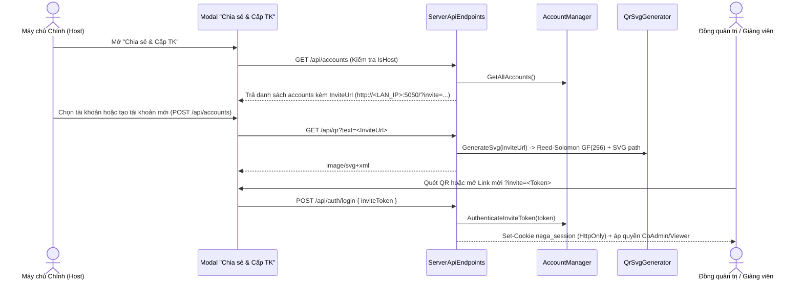

# F06 - Cấp Tài Khoản Phân Quyền, Link Mời & QR Code SVG Offline

## 1. Mục Tiêu & Yêu Cầu Kỹ Thuật

Chức năng `F06` cho phép Máy chủ Chính (`Host`) chia sẻ quyền truy cập Nega Dashboard cho đồng đội, trợ giảng hoặc giảng viên chấm thi trong mạng LAN một cách trực quan thông qua quản lý tài khoản theo vai trò (`Host` / `CoAdmin` / `Viewer`), Link mời đăng nhập 1 chạm và mã QR Code hiển thị offline không cần Internet.

### Các yêu cầu cốt lõi
* **Quản trị danh sách tài khoản tập trung (`AccountManager`):** Khởi tạo sẵn 3 tài khoản mẫu (`admin` quyền `Host`, `coadmin` quyền `CoAdmin`, `viewer` quyền `Viewer`) với mật khẩu ngẫu nhiên theo phiên; hỗ trợ `Host` tạo mới/cập nhật hoặc thu hồi tài khoản (đồng thời hủy ngay mọi phiên đang đăng nhập của tài khoản bị xóa, bảo vệ chống xóa nhầm tài khoản gốc `admin`).
* **Link mời 1 chạm (`?invite=<InviteToken>`):** Mỗi tài khoản có `InviteToken` 32 ký tự Hex sinh từ `RandomNumberGenerator.GetBytes(16)`. Khi máy khác mở link `http://<Server_LAN_IP>:5050/?invite=<Token>`, trình duyệt tự động gửi token lên `/api/auth/login` để lấy Cookie `HttpOnly` và xóa token khỏi thanh địa chỉ bằng `window.history.replaceState`.
* **Bộ sinh QR Code SVG hoàn toàn Offline (`QrSvgGenerator`):** Cài đặt thuật toán tạo mã QR chuẩn **ISO/IEC 18004** (Byte Mode, mức sửa lỗi ECC-L, Version 1..6 hỗ trợ tối đa 130 byte, nhân đa thức Reed-Solomon trên trường hữu hạn `GF(256)` với đa thức sinh `0x11D`), xuất thẳng `<svg>` độ nét cao tại endpoint `GET /api/qr?text=...` để quét trực tiếp từ điện thoại/laptop trong phòng lab không có Internet.

---

## 2. Luồng Cấp Tài Khoản & Đăng Nhập Bằng QR Code

---

## 3. Các Tệp Mã Nguồn & Kiểm Thử Triển Khai

* **Quản lý tài khoản & phiên:** [`src/Nega.Server/State/AccountManager.cs`](../../../src/Nega.Server/State/AccountManager.cs)
* **Bộ sinh QR SVG offline ISO/IEC 18004:** [`src/Nega.Server/Bridge/QrSvgGenerator.cs`](../../../src/Nega.Server/Bridge/QrSvgGenerator.cs)
* **API tài khoản & giao diện modal chia sẻ:** [`src/Nega.Server/Bridge/ServerApiEndpoints.cs`](../../../src/Nega.Server/Bridge/ServerApiEndpoints.cs), [`src/Nega.Server/wwwroot/js/nega-app.js`](../../../src/Nega.Server/wwwroot/js/nega-app.js)
* **Kiểm thử tự động:** [`tests/Nega.Tests/AccountManagerAndQrTests.cs`](../../../tests/Nega.Tests/AccountManagerAndQrTests.cs)
