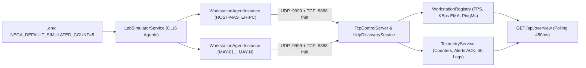

# F07 - Cụm Giả Lập Phòng Máy Thật & Telemetry Thời Gian Thực

## 1. Mục Tiêu & Yêu Cầu Kỹ Thuật

Để kiểm thử tải phòng máy ngay trên một máy lập trình viên hoặc kết hợp trình diễn song song giữa máy ảo và máy trạm thật trong LAN, chức năng `F07` vận hành cụm Agent qua đúng giao thức mạng thật (`UdpDiscoveryAgent` + `TcpClientAgent`) kèm hệ thống đo đạc thông số mạng (`TelemetryService`).

### Các yêu cầu cốt lõi
* **Giả lập giao tiếp qua Socket thật (`WorkstationAgentInstance` & `LabSimulatorService`):** Mỗi máy trạm giả lập (`MAY-01`..`MAY-16`) là một thực thể hoàn chỉnh mở socket UDP `:9999` và kết nối TCP `:8888` riêng biệt tới Server (không đọc biến nhớ nội bộ giả dối), nhận đủ gói `DISCOVER`, gửi `ANNOUNCE`, thực hiện `Handshake`, nén ảnh thật bằng `SimpleJpegEncoder` và xử lý mọi lệnh `CmdLockInput`/`CmdAlert`/`CmdShutdown`.
* **Điều chỉnh quy mô động (0..16 máy):** Người dùng có quyền `Host` / `CoAdmin` có thể tăng/giảm số lượng máy ảo ngay trên Dashboard (`POST /api/simulator`); mặc định khi khởi động đọc từ `NEGA_DEFAULT_SIMULATED_COUNT` (mặc định `5`).
* **Đo đạc Telemetry & EMA Smoothing:**
  * Đếm nguyên tử (`Interlocked`) tổng số gói UDP (`udpPackets`), tổng số frame JPEG (`tcpFrames`) và số lệnh điều khiển đã gửi (`commandsSent`).
  * Tính toán tốc độ khung hình (`CurrentFps`) và băng thông (`BandwidthKbps`) theo bộ lọc trung bình trượt hàm mũ (`0.65 * cũ + 0.35 * mới`) trong `WorkstationRegistry.UpdateScreenFrame`.
  * Đo độ trễ `PingMs` chính xác bằng chu kỳ `0x08 PING_PONG` mỗi 5 giây.
  * Hàng đợi nhật ký `ConcurrentQueue<ActivityLogEntry>` giữ tối đa **60 bản ghi** gần nhất, gắn nhãn người thực thi `[@username]`.

---

## 2. Kiến Trúc Vận Hành Cụm Giả Lập & Thu Thập Telemetry

---

## 3. Các Tệp Mã Nguồn & Kiểm Thử Triển Khai

* **Dịch vụ Simulator tích hợp Server:** [`src/Nega.Server/Bridge/LabSimulatorService.cs`](../../../src/Nega.Server/Bridge/LabSimulatorService.cs)
* **Thực thể Agent độc lập & CLI Agent:** [`src/Nega.Agent/Simulator/WorkstationAgentInstance.cs`](../../../src/Nega.Agent/Simulator/WorkstationAgentInstance.cs), [`src/Nega.Agent/Program.cs`](../../../src/Nega.Agent/Program.cs)
* **Dịch vụ Telemetry & trạng thái:** [`src/Nega.Server/State/TelemetryService.cs`](../../../src/Nega.Server/State/TelemetryService.cs), [`src/Nega.Server/State/WorkstationRegistry.cs`](../../../src/Nega.Server/State/WorkstationRegistry.cs)
* **Kiểm thử tự động:** [`tests/Nega.Tests/TelemetryAndNetworkTests.cs`](../../../tests/Nega.Tests/TelemetryAndNetworkTests.cs), [`tests/Nega.Tests/WorkstationRegistryTests.cs`](../../../tests/Nega.Tests/WorkstationRegistryTests.cs)
