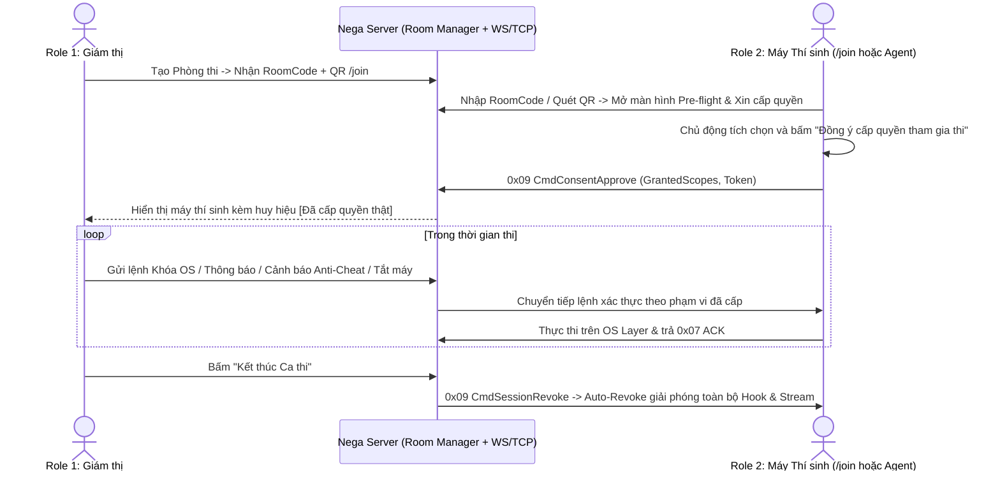

# F08 - Định Hướng Mở Rộng Mô Hình Thi Cử 2 Vai Trò `[Đề xuất Giai đoạn 2]`

:::warning[Trạng thái Đặc tả: Đề xuất / Roadmap theo Đề cương]
Các thành phần trong mục `F08` đã được đặc tả chi tiết trong hồ sơ đề cương nghiên cứu (`DeCuong.docx`) theo định hướng phát triển mới nhất, **chưa cài đặt vào mã nguồn vận hành hiện tại (`src/`)**. Mục tiêu là chuẩn bị kiến trúc mở rộng rạch ròi cho giai đoạn triển khai tiếp theo.
:::

---

## 1. Bối Cảnh & Mục Tiêu Nghiệp Vụ Mở Rộng

Thay vì chỉ dùng `Nega.Agent` cố định trong phòng lab đóng, mô hình mở rộng phục vụ các kỳ thi thực hành cho phép kết nối linh hoạt theo **2 vai trò tách biệt**:

1. **Role 1 — Người theo dõi (Giám thị / Quản trị phòng thi):** Khởi tạo **Phòng thi (Exam Room)** kèm **Mã phòng (`RoomCode`)** và link tham gia `/join`, theo dõi toàn bộ màn hình thật của các thí sinh, nhận cảnh báo bất thường (Anti-Cheat) và kích hoạt các lệnh điều khiển có hiệu lực thật lên hệ điều hành máy thí sinh.
2. **Role 2 — Máy bị theo dõi (Thí sinh):** Tham gia phòng thi bằng cách nhập **Mã phòng** hoặc mở link `/join`. Trước khi chia sẻ màn hình hoặc nhận lệnh điều khiển, máy thí sinh phải đi qua quy trình minh bạch gồm **Pre-flight Check** (kiểm tra quyền OS như Screen Recording / Accessibility trên macOS, quyền Hook trên Windows) và **Bảng Xin Cấp Quyền (Permission Consent)** có sự đồng thuận chủ động của thí sinh.

---

## 2. Phân Tích Tính Khả Thi Lai (App Desktop + Web `/join`)

Do giới hạn Sandbox bảo mật của trình duyệt web hiện đại, dự án đề xuất mô hình lai (**Hybrid Architecture**):

| Tác Động Thật Trên Máy Thí Sinh | App Desktop (`Nega.Agent` — Win/macOS) | Trình Duyệt Web (`/join` — Không cần cài) |
|---|---|---|
| Xin cấp quyền & Chia sẻ màn hình thật | Khả thi 100% (Toàn màn hình OS) | Khả thi 100% qua API `getDisplayMedia` + WebSocket |
| Khóa chuột & bàn phím toàn hệ điều hành | Khả thi 100% trên Windows (`SetWindowsHookEx` + TopMost); ~85% macOS (`Kiosk Overlay`) | Giới hạn trong tab (Fullscreen + PointerLock); nhưng phát hiện 100% `Esc` / `Alt+Tab` (Anti-Cheat) |
| Bật Thông báo khẩn nổi trên mọi ứng dụng | Khả thi 100% (`WinForms TopMost` / `AppKit`) | Popup trong trình duyệt + WebAudio / OS Notification API |
| Tắt máy tính thật (`shutdown`) | Khả thi 100% (`shutdown /s` trên Windows; `osascript`/`sudo` trên macOS) | Không khả thi (trình duyệt cấm tắt nguồn OS) |
| Điều khiển click chuột / gõ phím từ xa | Khả thi 100% (`SendInput` Win32 / `CGEvent` macOS) | Không điều khiển ngoài tab (chỉ hiển thị con trỏ chỉ dẫn) |

---

## 3. Luồng Giao Thức Đề Xuất (`Consent Handshake` & `Auto-Revoke`)

